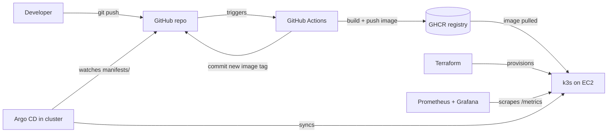

# gitops-k8s-platform

A small GitOps platform: **Terraform** provisions a k3s Kubernetes cluster on AWS, **GitHub Actions** builds a Docker image, and **Argo CD** deploys it automatically from git. **Prometheus + Grafana** monitor it.

Push code to `main` and the app updates on the cluster with no manual `kubectl apply`.

## Architecture



## Repo layout

| Path | Purpose |
|------|---------|
| `app/` | Flask app (`/`, `/health`, `/metrics`) and Dockerfile |
| `terraform/` | EC2 + security group + k3s install |
| `manifests/` | Kubernetes Deployment and Service (the source of truth Argo CD watches) |
| `argocd/application.yaml` | Tells Argo CD what to sync |
| `.github/workflows/ci.yml` | Build image, push to GHCR, update the image tag in git |

## Prerequisites

- AWS account, AWS CLI configured, an EC2 key pair
- Terraform >= 1.5, kubectl, Docker
- This repo pushed to GitHub as `nikhil-flux/gitops-k8s-platform` (change the name in `argocd/application.yaml` and `manifests/deployment.yaml` if different)

## Step 1: Provision the cluster

```bash
cd terraform
terraform init
terraform apply -var="key_name=<your-key-pair>" -var="my_ip_cidr=<your-ip>/32"
```

> `t3.small` is not free-tier. Run `terraform destroy` when you are done to avoid charges.

Fetch the kubeconfig (see the `kubeconfig_hint` output), replace `127.0.0.1` with the public IP, then:

```bash
export KUBECONFIG=./k3s.yaml
kubectl get nodes
```

## Step 2: Install Argo CD

```bash
kubectl create namespace argocd
kubectl apply -n argocd -f https://raw.githubusercontent.com/argoproj/argo-cd/stable/manifests/install.yaml
kubectl -n argocd patch svc argocd-server -p '{"spec":{"type":"NodePort"}}'
kubectl -n argocd get secret argocd-initial-admin-secret -o jsonpath="{.data.password}" | base64 -d
```

## Step 3: Let Argo CD manage the app

```bash
kubectl apply -f argocd/application.yaml
```

Make the GHCR package public (GitHub > Packages > gitops-demo-app > Package settings) so the cluster can pull it without credentials.

## Step 4: Test the GitOps loop

1. Change `APP_VERSION` or the response text in `app/app.py` and push to `main`.
2. Watch the Actions run build the image and commit a new tag to `manifests/deployment.yaml`.
3. Argo CD detects the commit and rolls out the new version.
4. Check: `curl http://<public-ip>:30080/`

## Step 5: Monitoring

```bash
helm repo add prometheus-community https://prometheus-community.github.io/helm-charts
helm install monitoring prometheus-community/kube-prometheus-stack -n monitoring --create-namespace
```

Expose Grafana with a NodePort, then add a dashboard on `app_requests_total` and `app_request_seconds`.

## Roadmap

- [ ] Add a staging and prod overlay with Kustomize
- [ ] Add a ServiceMonitor for the app
- [ ] Add Trivy image scanning to CI
- [ ] Screenshots of Argo CD and Grafana in `docs/`

## Cleanup

```bash
cd terraform && terraform destroy
```
